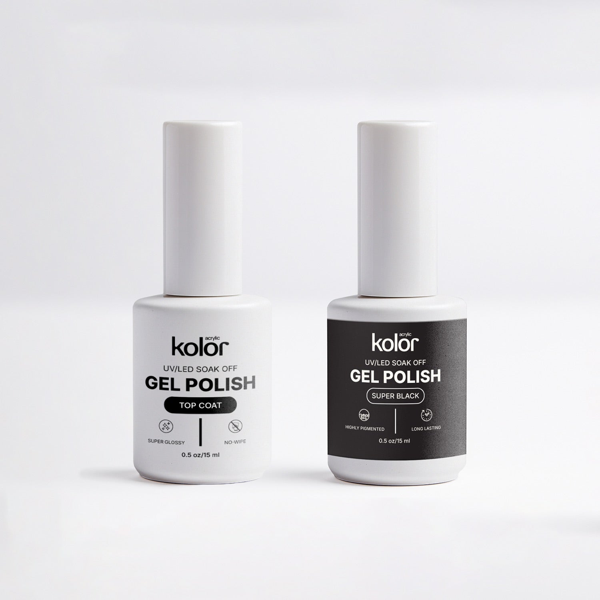

# Storyboard — KOLOR-2026-10-COMBO

> Sinh từ `scripts/storyboard.json` bằng `_tools/storyboard.py` — sửa JSON rồi chạy lại, không sửa tay file này.
> 20s · 9:16 · Voiceover

**Look chung:** Studio sáng, nền trắng / xám nhạt trơn (#f2f2f2) như ảnh official. Sáng mềm từ frame-left ở mọi cảnh. Chỉ thấy tay: tay khách da nâu ấm, móng tự nhiên ngắn-vừa dáng vuông bo; tay thợ vào từ frame-right. Cận / macro, chừa 1/3 trên cho chữ.

| Cảnh | Thời gian | Mục đích | Ảnh | Hình (mô tả) | Lời thoại / VO | Dịch | Ước tính lời | Chữ trên màn hình | Công cụ · render/dùng | Lưu về |
|---|---|---|---|---|---|---|---|---|---|---|
| S01 | 0.0–3.0s | Hook: nét cọ đen đầu tiên trên móng trần |  | Macro tay khách đặt phẳng, móng trần. Tay thợ cầm nắp trắng, cọ dẹt đầy gel đen tuyền, kéo 1 nét từ gốc tới đầu móng giữa. Cuối cảnh móng giữa đã có 1 vệt đen bóng giữa móng. | Two bottles. Endless sets. | Hai chai. Vô số bộ móng. | 4 từ ≈ 1.7s · cảnh dùng 3s ✅ | 2 BOTTLES. / ENDLESS SETS. | Google Flow (Veo 3.1) · image-to-video · 9:16 · user tự render (test) · 8s/3.0s | outputs/videos/KOLOR-2026-10-COMBO_S01_first-stroke_v1.mp4 |
| S02 | 3.0–6.5s | Proof: màu đậm, phủ đều |  | Cận tay khách: móng trỏ + giữa đã đen phủ kín, cọ đang phủ móng áp út từ gốc tới đầu. Chai Super Black đứng mờ phía sau. Cuối cảnh móng áp út đen đều, không vệt. | Highly pigmented black. Smooth, even coverage. | Màu đen đậm. Phủ mượt, đều. | 6 từ ≈ 2.5s · cảnh dùng 3.5s ✅ | HIGHLY PIGMENTED | Google Flow (Veo 3.1) · image-to-video · 9:16 · user tự render (test) · 8s/3.5s | outputs/videos/KOLOR-2026-10-COMBO_S02_even-coverage_v1.mp4 |
| S03 | 6.5–9.0s | Bước hơ đèn UV/LED |  | Góc 3/4: tay khách 4 móng đen trượt vào đèn LED trắng trơn, đèn sáng trắng-tím hắt lên móng. | Cures fast under UV or LED. | Khô nhanh dưới đèn UV hoặc LED. | 6 từ ≈ 2.5s · cảnh dùng 2.5s ✅ | UV/LED CURE | Google Flow (Veo 3.1) · image-to-video · 9:16 · user tự render (test) · 8s/2.5s | outputs/videos/KOLOR-2026-10-COMBO_S03_led-cure_v1.mp4 |
| S04 | 9.0–13.0s | Top coat: satin thành bóng gương, no-wipe |  | Macro 4 móng đen satin. Cọ top coat trong suốt quét móng giữa từ gốc tới đầu, phần đã quét bóng gương có vệt sáng trắng sắc, phần chưa quét vẫn satin. | Then the top coat. Super glossy. No wipe. | Rồi tới top coat. Siêu bóng. Không cần lau. | 8 từ ≈ 3.3s · cảnh dùng 4s ✅ | SUPER GLOSSY / NO-WIPE | Google Flow (Veo 3.1) · image-to-video · 9:16 · user tự render (test) · 8s/4.0s | outputs/videos/KOLOR-2026-10-COMBO_S04_topcoat-glass_v1.mp4 |
| S05 | 13.0–16.5s | Kết quả: móng đen bóng gương, 2 chai phía sau |  | Tay khách giơ nghiêng về máy, xoay nhẹ cổ tay; vệt sáng dài lướt qua 4 móng đen bóng như kính. Phía sau mờ: chai Top Coat + chai Super Black. | Seals in your color. Helps prevent chipping. | Khoá màu lại. Giúp hạn chế mẻ móng. | 7 từ ≈ 2.9s · cảnh dùng 3.5s ✅ | SEALS IN COLOR | Google Flow (Veo 3.1) · image-to-video · 9:16 · user tự render (test) · 8s/3.5s | outputs/videos/KOLOR-2026-10-COMBO_S05_mirror-shine_v1.mp4 |
| S06 | 16.5–20.0s | End card + CTA |  | Ảnh thật 2 chai Glossy Top Coat + Super Black, đẩy vào chậm; 1.8s chuyển mềm sang ảnh Top Coat + Super White. Logo kolor trên, tên combo + 'Black or White' + nút 'Shop now' dưới. | The Kolor Combo. Black or white. | Combo Kolor. Đen hoặc trắng. | 6 từ ≈ 2.5s · cảnh dùng 3.5s ✅ | kolor / Top Coat + Gel Polish Combo / Black or White / Shop now | Remotion · ảnh thật official-01 → official-05 | remotion-project (scene S06) |

## Prompt từng cảnh (EN → dịch VI)

### S01

**Prompt ảnh (khung đầu):**

```
Scene: bright nail studio table, plain light grey seamless background, white surface. Subject: extreme close-up of a client's relaxed hand resting flat, nails bare and natural. A nail technician's fingers enter from frame-right holding a slim white cylindrical bottle cap with a flat black gel brush loaded with thick jet-black gel, the brush tip touching the cuticle of the middle fingernail. Important Details: soft diffused daylight from frame-left, warm medium-brown skin with natural texture, short-to-medium rounded-square nails, middle nail at frame center, empty top third for text. Use Case: vertical 9:16 first frame for a gel polish ad. Constraints: two hands only, five fingers each, no text, no logos.
```

**Dịch:** Cảnh: bàn làm nail sáng, nền xám nhạt trơn, mặt bàn trắng. Chủ thể: macro tay khách thả lỏng đặt phẳng, móng trần tự nhiên. Ngón tay thợ vào từ phải, cầm nắp trắng trụ thon có cọ dẹt đen đầy gel đen tuyền, đầu cọ chạm gốc móng giữa. Chi tiết: sáng mềm từ trái, da nâu ấm có kết cấu thật, móng ngắn-vừa vuông bo, móng giữa ở tâm khung, chừa 1/3 trên cho chữ. Mục đích: khung đầu 9:16 cho ad gel. Ràng buộc: chỉ 2 bàn tay, mỗi tay 5 ngón, không chữ, không logo.

**Prompt video (nháp — chốt lại ở cổng 2 theo ảnh thật):**

```
Maintain the subject from the first frame. The technician draws the brush in one slow, steady stroke from the cuticle to the free edge of the middle nail, leaving a smooth glossy jet-black stripe down its center. The client's hand stays still. Static macro camera, very slight push-in. Soft daylight from frame-left. No dialogue, no music, no sound effects; quiet natural ambience only.
```

**Dịch:** Giữ chủ thể như khung đầu. Thợ kéo cọ 1 nét chậm, đều từ gốc tới mép móng giữa, để lại vệt đen tuyền bóng mượt giữa móng. Tay khách đứng yên. Máy macro đứng yên, đẩy vào rất nhẹ. Sáng mềm từ trái. Không thoại, không nhạc, không SFX; chỉ tiếng nền tự nhiên nhẹ.

**Ghi chú:** Rủi ro AI: cọ đổi dáng, gel lan ra da. Giữ 1 nét duy nhất. Dùng 3s đầu của clip 8s.

### S02

**Prompt ảnh (khung đầu):**

```
Scene: bright nail studio table, plain light grey seamless background, white surface. Subject: close-up of a client's hand resting flat; index and middle nails fully coated in opaque jet-black gel, a technician's black gel brush from frame-right touching the cuticle of the bare ring nail. In soft focus behind, the Super Black bottle from Image 2 (white body, charcoal-black wrap label, tall white cap) stands upright. Important Details: soft daylight from frame-left, warm medium-brown skin from Image 1, smooth streak-free black coats, empty top third for text. Use Case: vertical 9:16 first frame for a gel polish ad. Constraints: only one bottle in frame, label matches Image 2, two hands only, five fingers each, no added text.
```

**Dịch:** Cảnh: bàn nail sáng, nền xám nhạt trơn. Chủ thể: cận tay khách đặt phẳng; móng trỏ + giữa đã phủ đen kín, cọ gel đen của thợ từ phải chạm gốc móng áp út còn trần. Phía sau mờ: chai Super Black theo Ảnh 2 (thân trắng, nhãn quấn xám than, nắp trắng cao). Chi tiết: sáng mềm từ trái, da theo Ảnh 1, lớp đen mượt không vệt, chừa 1/3 trên. Ràng buộc: chỉ 1 chai, nhãn đúng Ảnh 2, 2 bàn tay 5 ngón, không thêm chữ.

**Prompt video (nháp — chốt lại ở cổng 2 theo ảnh thật):**

```
Maintain the subject from the first frame. The technician glides the brush from cuticle to tip on the ring nail in two smooth passes, leaving a fully opaque, even jet-black coat with no streaks. The bottle in the background stays still and out of focus. Static close-up camera. Soft daylight from frame-left. No dialogue, no music, no sound effects; quiet natural ambience only.
```

**Dịch:** Giữ chủ thể như khung đầu. Thợ lướt cọ 2 nét mượt từ gốc tới đầu móng áp út, để lại lớp đen kín, đều, không vệt. Chai phía sau đứng yên, mờ. Máy cận đứng yên. Sáng mềm từ trái. Không thoại, không nhạc, không SFX.

**Ghi chú:** Nhãn chai mờ phía sau để giảm rủi ro chữ méo. Nhãn rõ chỉ dùng ảnh thật ở S06.

### S03

**Prompt ảnh (khung đầu):**

```
Scene: bright nail studio table, plain light grey seamless background, white surface. Subject: a client's hand with four jet-black gel nails, fingertips just at the opening of a compact plain white dome-shaped UV/LED nail lamp on frame-right, lamp switched off. Important Details: soft daylight from frame-left, warm medium-brown skin from Image 1, three-quarter side angle, wrist frame-left, empty top third. Use Case: vertical 9:16 first frame for a gel polish ad. Constraints: plain unbranded lamp with no text, one hand, five fingers.
```

**Dịch:** Cảnh: bàn nail sáng, nền xám nhạt trơn. Chủ thể: tay khách 4 móng gel đen, đầu ngón vừa tới miệng đèn LED trắng trơn dáng vòm (bên phải), đèn chưa bật. Chi tiết: sáng mềm từ trái, da theo Ảnh 1, góc 3/4, cổ tay bên trái, chừa 1/3 trên. Ràng buộc: đèn không chữ, không logo; 1 tay 5 ngón.

**Prompt video (nháp — chốt lại ở cổng 2 theo ảnh thật):**

```
Maintain the subject from the first frame. The hand slides slowly forward into the lamp and rests; the lamp switches on with a cool white-violet LED glow lighting the black nails from inside. Static camera. No dialogue, no music, no sound effects; quiet natural ambience only.
```

**Dịch:** Giữ chủ thể như khung đầu. Tay trượt chậm vào đèn rồi dừng; đèn bật sáng trắng-tím hắt lên móng đen từ bên trong. Máy đứng yên. Không thoại, không nhạc, không SFX.

**Ghi chú:** Cảnh ngắn 2.5s. Rủi ro: đèn tự hiện chữ, ngón tay xuyên vỏ đèn. Đèn trơn hoàn toàn.

### S04

**Prompt ảnh (khung đầu):**

```
Scene: bright nail studio table, plain light grey seamless background, white surface. Subject: extreme close-up of a client's hand with four jet-black nails in a soft satin finish. A technician's fingers from frame-right hold a slim white cylindrical cap with a flat black brush loaded with crystal-clear top coat gel, brush tip touching the cuticle of the middle nail. Important Details: soft daylight from frame-left, warm medium-brown skin from Image 1, middle nail at frame center, empty top third. Use Case: vertical 9:16 first frame for a gel top coat ad. Constraints: two hands only, five fingers each, no text.
```

**Dịch:** Cảnh: bàn nail sáng, nền xám nhạt trơn. Chủ thể: macro tay khách 4 móng đen satin. Ngón tay thợ từ phải cầm nắp trắng trụ thon, cọ dẹt đen đầy top coat trong suốt, đầu cọ chạm gốc móng giữa. Chi tiết: sáng mềm từ trái, da theo Ảnh 1, móng giữa ở tâm, chừa 1/3 trên. Ràng buộc: 2 bàn tay 5 ngón, không chữ.

**Prompt video (nháp — chốt lại ở cổng 2 theo ảnh thật):**

```
Maintain the subject from the first frame. The technician sweeps the clear top coat from cuticle to tip in one slow stroke; where the brush passes, the satin black turns mirror-glossy with a sharp white window reflection gliding along the nail. Static macro camera. Soft daylight from frame-left. No dialogue, no music, no sound effects; quiet natural ambience only.
```

**Dịch:** Giữ chủ thể như khung đầu. Thợ quét top coat trong 1 nét chậm từ gốc tới đầu; chỗ cọ đi qua, đen satin thành bóng gương, vệt phản chiếu cửa sổ trắng lướt dọc móng. Máy macro đứng yên. Không thoại, không nhạc, không SFX.

**Ghi chú:** Cảnh chứng minh claim Super Glossy. No-wipe thể hiện bằng chữ + VO (không có bước lau ở S05).

### S05

**Prompt ảnh (khung đầu):**

```
Scene: bright clean studio, plain light grey seamless background, white surface. Subject: a client's hand raised and angled toward the camera, four mirror-glossy jet-black nails with crisp reflections. Behind the hand in soft focus, the two bottles from Image 2 stand side by side: white Top Coat bottle on the left, Super Black bottle with charcoal label on the right, both with tall white caps. Important Details: soft daylight from frame-left, warm medium-brown skin from Image 1, hand center-lower, bottles lower background, empty top third. Use Case: vertical 9:16 first frame for a gel polish ad. Constraints: exactly two bottles matching Image 2, one hand, five fingers, no added text.
```

**Dịch:** Cảnh: studio sáng, nền xám nhạt trơn. Chủ thể: tay khách giơ nghiêng về máy, 4 móng đen bóng gương, phản chiếu sắc. Phía sau mờ: 2 chai theo Ảnh 2 đứng cạnh nhau (Top Coat trắng bên trái, Super Black nhãn xám than bên phải, nắp trắng cao). Chi tiết: sáng mềm từ trái, da theo Ảnh 1, tay ở giữa-dưới, chừa 1/3 trên. Ràng buộc: đúng 2 chai như Ảnh 2, 1 tay 5 ngón, không thêm chữ.

**Prompt video (nháp — chốt lại ở cổng 2 theo ảnh thật):**

```
Maintain the subject from the first frame. The hand rotates slowly at the wrist by a few degrees; a long bright highlight glides across all four glossy black nails. Bottles stay still in soft focus. Static camera. No dialogue, no music, no sound effects; quiet natural ambience only.
```

**Dịch:** Giữ chủ thể như khung đầu. Cổ tay xoay chậm vài độ; vệt sáng dài lướt qua cả 4 móng đen bóng. Chai đứng yên, mờ. Máy đứng yên. Không thoại, không nhạc, không SFX.

**Ghi chú:** Rủi ro: chai đổi nhãn khi tay xoay. Chai mờ sâu; nếu méo vẫn dùng được vì S06 có ảnh thật.

### S06

**Ghi chú:** Không dùng giá. Nút 'Shop now' mềm, không FOMO.

## Danh sách ảnh

| Mã | Nội dung | Vai trò | Cảnh | Nguồn | Ref |
|---|---|---|---|---|---|
| A-01 | Tay khách da nâu ấm, móng trần ngắn-vừa vuông bo, nền xám nhạt | ref tay (giữ đồng nhất) | S01–S05 | tạo mới | — |
| B-01 | Cọ gel đen chạm gốc móng giữa, móng trần | first frame | S01 | tạo mới | A-01 |
| B-02 | 2 móng đen, cọ chạm móng áp út, chai Super Black mờ | first frame | S02 | tạo mới | A-01 + official-01 |
| B-03 | Tay 4 móng đen ở miệng đèn LED trắng trơn | first frame | S03 | tạo mới | A-01 |
| B-04 | 4 móng đen satin, cọ top coat chạm gốc móng giữa | first frame | S04 | tạo mới | A-01 |
| B-05 | Tay giơ 4 móng đen bóng gương, 2 chai mờ phía sau | first frame | S05 | tạo mới | A-01 + official-01 |
| — | combo_official-01.jpg + combo_official-05.jpg | end card | S06 | ảnh thật | — |

## Danh sách asset

| Asset | Loại | Nguồn | Tên file | Ai làm | Render (s) | Dùng (s) |
|---|---|---|---|---|---|---|
| S01 | clip | gen mới | KOLOR-2026-10-COMBO_S01_first-stroke_v1.mp4 | User (Flow) | 8 | 3.0 |
| S02 | clip | gen mới | KOLOR-2026-10-COMBO_S02_even-coverage_v1.mp4 | User (Flow) | 8 | 3.5 |
| S03 | clip | gen mới | KOLOR-2026-10-COMBO_S03_led-cure_v1.mp4 | User (Flow) | 8 | 2.5 |
| S04 | clip | gen mới | KOLOR-2026-10-COMBO_S04_topcoat-glass_v1.mp4 | User (Flow) | 8 | 4.0 |
| S05 | clip | gen mới | KOLOR-2026-10-COMBO_S05_mirror-shine_v1.mp4 | User (Flow) | 8 | 3.5 |
| S06 | end card | ảnh thật + Remotion | — | Claude | — | 3.5 |
| VO S01–S06 | audio | OpenAI TTS (nova) | KOLOR-2026-10-COMBO_vo-S01_v1.mp3 … | Claude | — | — |
| Nhạc + SFX | audio | user tự chọn theo audio-plan | KOLOR-2026-10-COMBO_music_v1.mp3 | User | — | 20 |
